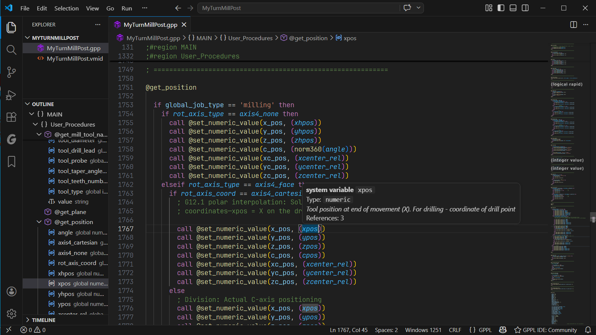

# Postprocessor IDE for SolidCAM

[](https://marketplace.visualstudio.com/items?itemName=anzory.vscode-gppl-ide)
[](https://marketplace.visualstudio.com/items?itemName=anzory.vscode-gppl-ide)
[](https://marketplace.visualstudio.com/items?itemName=anzory.vscode-gppl-ide&ssr=false#review-details)

Write and maintain GPPL postprocessors for **SolidCAM and InventorCAM** in Visual Studio Code. Community provides completion, navigation, diagnostics, and formatting for individual `.gpp` files.

**[Website](https://gppl-ide.ru/) · [Documentation](https://gppl-ide.ru/docs/) · [Install Community](https://marketplace.visualstudio.com/items?itemName=anzory.vscode-gppl-ide)**

[](https://gppl-ide.ru/#screenshots)

## What you can do

- **Write with context.** Semantic highlighting, hover descriptions, signature help, and completion for your symbols, **1633 system variables**, **199 system procedures**, and **95 built-in functions**. [Editor guide](https://gppl-ide.ru/docs/editor/). Newly recognized catalog names may have no description or confirmed type yet.
- **Complete calls faster.** Procedure and built-in function completion inserts argument placeholders; a selected expression can become the first argument.
- **Find and fix problems.** Syntax, semantic, and encoding diagnostics with Quick Fixes for supported issues, including duplicate declarations and missing block endings. [Diagnostics guide](https://gppl-ide.ru/docs/diagnostics/).
- **Navigate your code.** Go to Definition, Find All References, and scope-aware Rename within a file, plus Outline, folding, snippets, and formatting.
- **Use machine parameters.** Recognize supported user variables from the matching `.vmid` file in completion, hover, and type checking. [VMID guide](https://gppl-ide.ru/docs/vmid/).

Descriptions, diagnostics, and extension UI follow VS Code's display language: **English, Russian, or German**.

## Community and PRO

**Community is free and available now.** Its symbol analysis operates within the current file.

**PRO is in closed beta and has not been publicly released.** Project navigation and cross-file analysis are being tested with invited participants. See [edition availability and comparison](https://gppl-ide.ru/editions/).

## Get started

Requires **Windows x64 and VS Code 1.85 or later**. The language server includes its .NET runtime.

Install from the [Visual Studio Marketplace](https://marketplace.visualstudio.com/items?itemName=anzory.vscode-gppl-ide), or run:

```sh
code --install-extension anzory.vscode-gppl-ide
```

Open a `.gpp` file, press **Ctrl+Space** for completion, **F12** for a definition, or **Ctrl+.** on a diagnostic for available fixes.

For offline installation, download the Community VSIX from [GitHub Releases](https://github.com/anzory/SolidCAM-GPPL-IDE/releases) and choose **Extensions → … → Install from VSIX…**. Follow the [quick start](https://gppl-ide.ru/docs/) for setup and first steps.

### Check your file encoding

The default is **Windows-1252**. For Cyrillic postprocessors, configure **Windows-1251** for both `gppl.encoding` and VS Code's GPPL file encoding. If text opens incorrectly, use **Reopen with Encoding** before saving. See the [encoding guide](https://gppl-ide.ru/docs/encoding/) for settings and the difference between reopening and converting a file.

## Help and release notes

- [Settings](https://gppl-ide.ru/docs/settings/) and [troubleshooting](https://gppl-ide.ru/docs/troubleshooting/)
- [Changelog](CHANGELOG.md) and [release downloads](https://github.com/anzory/SolidCAM-GPPL-IDE/releases)
- [Report an issue or request a feature](https://github.com/anzory/SolidCAM-GPPL-IDE/issues)
- [Security reporting policy](SECURITY.md)

## License and acknowledgements

The extension client is **MIT-licensed**; the language server binary is **proprietary**. See [LICENSE](LICENSE).

Built with ANTLR 4, OmniSharp LSP, Serilog, and .NET. Component licenses and attribution are included in [THIRD_PARTY_NOTICES.md](THIRD_PARTY_NOTICES.md).

> **Disclaimer.** This is an **unofficial, independently developed** extension. "SolidCAM" is a registered trademark of SolidCAM Ltd. "GPPL" (General Post-Processor Language) refers to the proprietary postprocessor language used by SolidCAM products. This extension is **not affiliated with, endorsed by, sponsored by, or supported by SolidCAM Ltd**. All trademarks are the property of their respective owners.
